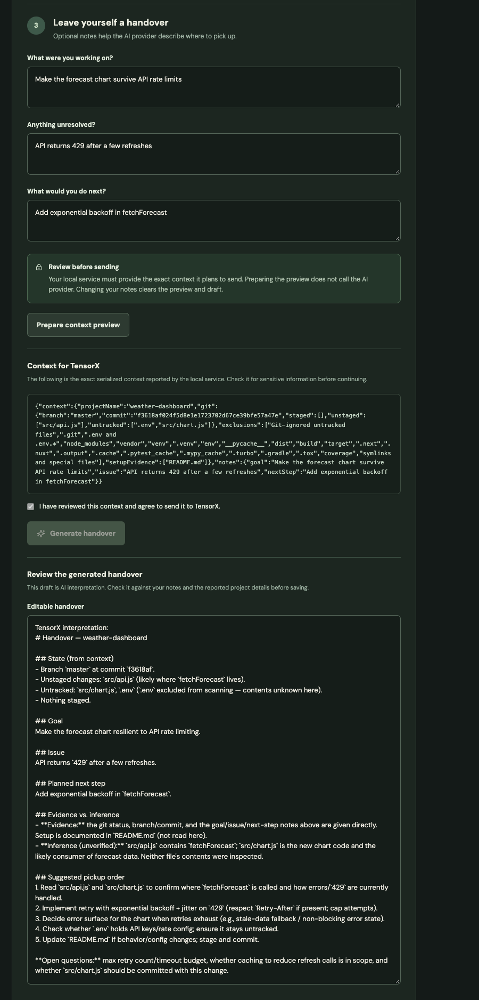
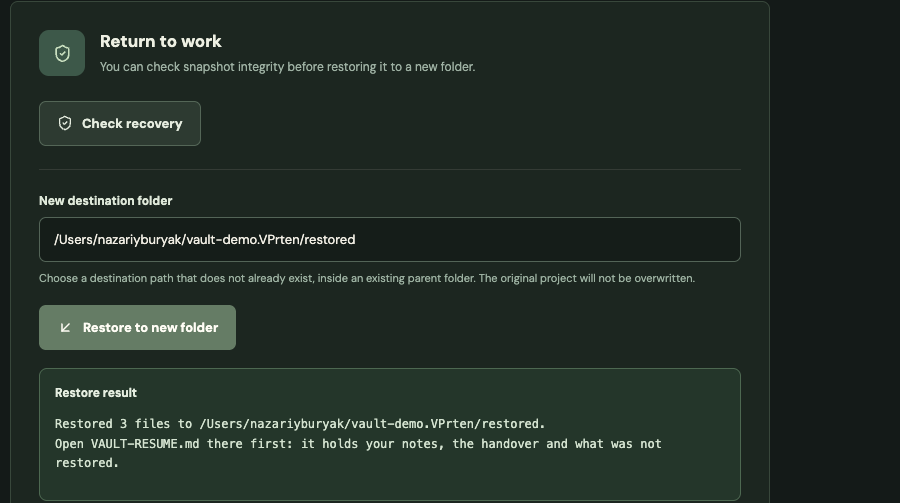
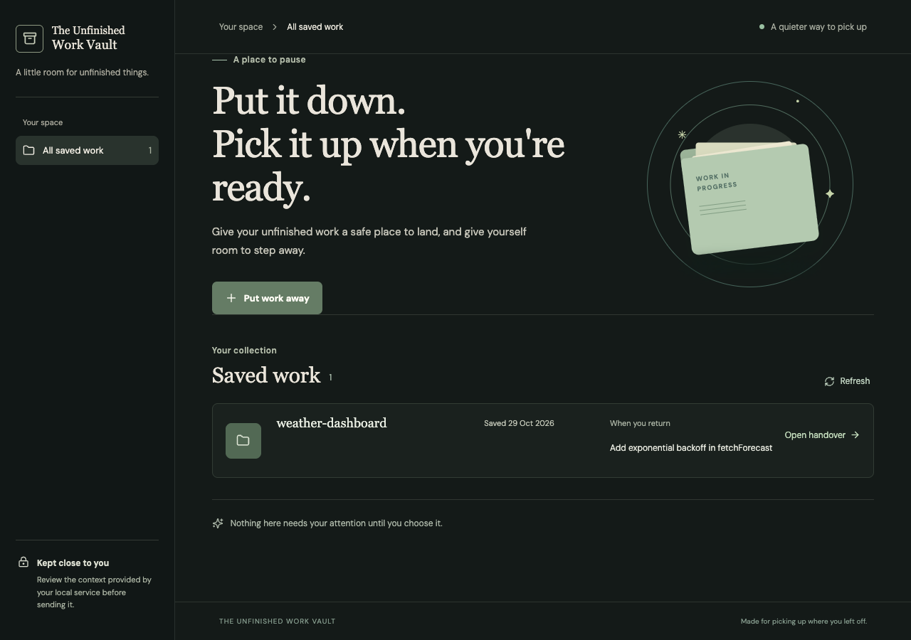

# The Unfinished Work Vault

**Put unfinished AI-assisted work down at the end of the day, and pick it up again without rebuilding context.**

Entry for the Claude Code Impact Lab Dublin (29 October 2026), challenge: **compression burnout**.

**Evaluating this entry?** [JUDGING.md](JUDGING.md) has a five-minute check, evidence for each criterion with code and test links, a recorded live run, and limitations.

## Who it is for and the problem

Developers who work with AI coding agents. Agents make each task faster, so people take on more of them, and the day ends with several half-finished branches, uncommitted changes and context that lives only in their head. Stopping feels risky, so evenings get used to "just finish" or to keep the state in mind. That is the compression-burnout pattern described in the brief.

**Direction:** our take on the brief's *shutdown command* direction, combined with an *understanding check* before work is resumed. We do not pause agents. We make it safe to stop.

## What it does (implemented, end to end)

The dashboard also finds recent local Git projects from Codex and Claude Code session metadata automatically. These appear under **Recently worked on**; select one to prefill its path. Discovery is local and does not save a snapshot or send a model request. [How discovery works and its limits](docs/project-discovery.md).

1. **Inspect:** choose a local Git project folder. The backend reads branch, HEAD, changed, staged and untracked files, and flags anything it cannot safely capture.
2. **Write a short handover:** add your goal, unresolved issue and next step, or use the `unfinished-work-vault` skill in Codex or Claude Code to prepare an importable JSON draft. Review and edit the notes. Choose a local handover with no model request, or explicitly review and consent to the exact context before generating with a configured model. A lightweight quality check flags missing notes and a few vague next steps.
3. **Vault it:** review eligible files and uncheck individual files you do not want captured. Selected working files and the handover are copied into a local vault with SHA-256 integrity hashes. Excluded files will not be recoverable from the snapshot. The original project is not modified.
4. **Come back later:** search saved notes and handovers, browse snapshots grouped by their original project, compare saved and current eligible files, and check snapshot integrity and captured setup evidence. Restore to a **new** folder, then copy the resume prompt into Codex or Claude Code. The resume note explains what was not restored. A portable handoff folder can also be created locally, with the files, resume note and hash manifest; inspect it for secrets and paths before sharing.

| Notes, consent and generated handover | Restore with resume note | Saved work |
| --- | --- | --- |
|  |  |  |

*Screenshots from a real browser run against a live model (TensorX, `deepseek/deepseek-v4.1-flash`) on a project from `scripts/make-demo-project.sh`.*

## Agent-assisted handover and limitations

Invoke `unfinished-work-vault` in the current Codex or Claude Code session and ask it to prepare a handover. Copy its JSON and choose **Import agent draft** in the review screen (or paste the JSON into the field), then inspect the imported notes and choose **Use notes as a local handover**. No conversation is imported automatically and no model request occurs for this local path. The optional provider path still requires reviewing and consenting to its exact context.

The stopping check reports Git changes and lets you list known tasks as a temporary reminder. You can check whether explicitly entered process IDs exist; this cannot verify their identity because IDs can be reused. It does not discover or stop processes. The quality check uses simple text heuristics, not an AI assessment. Comparison checks eligible file hashes and omits ignored and individually excluded files; it requires the original project to be available. Readiness checks integrity and which detected setup files were captured; it cannot verify installed dependencies, credentials, environment settings, or that the app runs. Portable handoff folders contain project files, notes and the original path; nothing is shared automatically and they must be reviewed before sharing.

## Workspaces and project history

- **Project status:** choose Work in progress, Done or Abandoned on a discovered project or a saved project's detail page. The status belongs to the original project path and is shared across its snapshots. Changing it does not delete, move or alter files.
- **Close my day:** select recent or saved projects, then inspect and review each one separately. Save or skip each and review the results. The queue and its results live in the current browser session; no agent or process is stopped.
- **Recovery workspace:** verify saved file hashes, compare with the current project when available, see detected setup-file evidence, and track your own recovery checklist. Checkmarks are user assertions, not tests. Restore uses the existing new-folder flow; no commands run automatically.
- **Project time machine:** open a snapshot to see its project's timeline, compare two snapshots, or open another snapshot to restore it. A difference can mean the capture selections differed; it does not prove the project changed.
- **Decision journal and context map:** add a hypothesis, approach, evidence, result and open question linked to a snapshot. The context map shows captured Git changes, setup files, filename-based test candidates, suggested issue links based on filename words, and up to five recent commits from the original repository. You can link an issue to a file captured in that snapshot. Links are user assertions.
- **Teammate handoff room:** export a snapshot to a new local folder from its detail page, then share the folder yourself. It includes a resume note, manifest, descriptor, and decision entries and links for that snapshot. A recipient can enter the folder path in the handoff room to inspect its contents and check the files against the supplied manifest, then download handback notes. The sender can paste the returned JSON in the room to read it. Neither export nor handback is sent automatically.

Project statuses, journal entries, context links and recovery checkmarks are stored locally under the vault root, separate from snapshot files. The end-of-day queue is not restored after a page reload. Exported handoff hashes are unsigned, and the descriptor and resume note are not authenticated: a matching manifest does not prove who sent the package or that its instructions are safe. Older exports without a handoff descriptor cannot be opened in the handoff room; create a new export. Review files, paths and notes for sensitive information before sharing.

## How it gives time back

- **Stopping can be simpler.** You do not need to finish, commit or remember anything first, so the evening is not spent closing loops.
- **Restarting costs less attention.** The handover and snapshot replace the 10 to 30 minutes typically spent working out "where was I?". That figure is our estimate, not a measurement.
- **It adds no recurring obligations.** There are no notifications, streaks, check-ins or tracking. The tool does nothing until you open it, and every prompt is optional.

## Evidence for the judging criteria

| Criterion | Where to look |
| --- | --- |
| Takes on the problem (30%) | Audience and problem above; [`docs/brief.md`](docs/brief.md) |
| Actually works (30%) | Real Git inspection, capture, hashing, verification and restore in [`backend/vault.mjs`](backend/vault.mjs); live Claude call in [`backend/claude.mjs`](backend/claude.mjs); React UI in [`src/App.jsx`](src/App.jsx). Automated tests (`npm --prefix backend test`) run the real filesystem and Git code on temporary repositories, using a stubbed HTTP client for the model only. |
| Someone would use it (20%) | Three commands to run (below); local only, with no account or database; works on any Git project. |
| Gives time back (20%) | The section above. Consent before any model call, and an editable draft that is never auto-sent. |

**Status:** the React/Vite interface and local Node backend are integrated and covered by automated tests. **Live verification (29 October 2026):** with a real TensorX key and model `deepseek/deepseek-v4.1-flash`, both the direct API flow and the UI's endpoint sequence (inspect, preview, generate, save, verify, restore) completed against real Git projects created by `scripts/make-demo-project.sh`: restored files matched byte for byte, `.env` was excluded and the original project was unchanged. The same day, the complete UI flow was also run in a real browser (Chrome, via Playwright) against live TensorX; see `docs/screenshots/`. Live Anthropic access has not been verified. Local handovers, capture, verification, comparison, export and restore need no API key.

## Run the app

Requires Node.js 20+, npm and Git; the backend API walkthrough also uses curl and jq. From the repository root, install the frontend dependencies and check the code:

The reusable [`unfinished-work-vault` skill](skills/unfinished-work-vault/SKILL.md) can be installed under `~/.codex/skills/` for Codex or `~/.claude/skills/` for Claude Code. Start a new session after installation. Dashboard discovery works even when the skill is not invoked.

```sh
npm ci
npm run build
npm --prefix backend test
```

An API key is optional for local handovers. For AI generation, the backend uses Anthropic when `ANTHROPIC_API_KEY` is set and TensorX when only `TENSORX_API_KEY` is set (override with `HANDOVER_PROVIDER`). For Anthropic: In one terminal, set `ANTHROPIC_API_KEY` securely in the environment (never commit it) and start the backend:

```sh
npm --prefix backend start
```

In a second terminal, from the repository root, start the frontend and open the local URL printed by Vite:

```sh
npm run dev
```

No unfinished project to hand? Create a realistic half-finished one (an uncommitted fix, a new file and a fake `.env`) and paste the printed path into **Project folder**:

```sh
sh scripts/make-demo-project.sh
```

It only creates a new `~/vault-demo.*` directory and never changes existing projects.

The API listens on `127.0.0.1:3001` by default and is unauthenticated; run it only on a trusted machine. Generation requires the selected provider's key and can incur charges. Optional Anthropic settings are `ANTHROPIC_MODEL` and `ANTHROPIC_WORKSPACE_ID`; `VAULT_ROOT` and `PORT` apply to either provider. See the [backend API guide](docs/backend-api.md) for defaults, a reproducible Git example, schemas, and recovery commands.

## Optional TensorX provider: hidden key entry

The event allows any handover model (confirmed 29 October 2026); the product is built with Claude Code and the organiser's Claude judge is unchanged. TensorX may bill separately; do not assume Anthropic event credits apply. Check model access and charges before use.

In your own interactive macOS bash or zsh terminal (not one controlled or observed by an assistant), from the repository root, type or paste the following command, then enter your key at the prompt. The input is not echoed or inserted into shell command history. Do not send your key to an assistant, paste it into a command, or put it in the repository. Avoid terminal recordings or debugging/tracing that could expose it.

```sh
printf 'TensorX API key (hidden): '; IFS= read -rs TENSORX_API_KEY; printf '\n'; export TENSORX_API_KEY
```

In the **same terminal**, list model IDs available to that key. Python reads the secret from its environment rather than placing it in command-line arguments; the command prints IDs only. It makes a network request to TensorX. If Python reports `CERTIFICATE_VERIFY_FAILED` (common with python.org installers on macOS), run the `Install Certificates.command` in your Python application folder once.

```sh
python3 - <<'PY'
import http.client
import json
import os

connection = http.client.HTTPSConnection('api.tensorx.ai', timeout=30)
try:
    connection.request('GET', '/v1/models', headers={
        'Authorization': 'Bearer ' + os.environ['TENSORX_API_KEY'],
    })
    response = connection.getresponse()
    if response.status != 200:
        raise SystemExit(f'HTTP {response.status}')
    for model in json.load(response)['data']:
        print(model['id'])
finally:
    connection.close()
PY
```

Choose an exact available ID from that list, then enter it at the prompt and start the backend in the same terminal:

```sh
printf 'TensorX model ID: '; IFS= read -r TENSORX_MODEL; export TENSORX_MODEL
HANDOVER_PROVIDER=tensorx npm --prefix backend start
```

Start `npm run dev` in a second terminal as above. To switch providers, restart the backend with the desired configuration. TensorX documents its [API](https://docs.tensorx.ai/api-reference/overview) and [available models](https://docs.tensorx.ai/api-reference/models). The key remains in the current shell and child-process environments until unset or the shell exits; sufficiently privileged local processes may be able to read it. Hidden entry is not end-to-end encryption and does not protect against a compromised machine. After use, stop the backend and run `unset TENSORX_API_KEY` in that shell.

Before creating a vault, **review the capture preview and your notes**. If using a provider, also review the provider-context preview and explicitly consent. The preview identifies the selected provider. File contents are not sent to that provider by default, but project names, Git paths, setup names and notes can be sensitive. The snapshot and handover are stored locally. Git-ignored untracked files are skipped, but tracked or unignored secrets can still be captured. Capture refuses files with both staged and unstaged changes to avoid silently losing staged work. Repositories with active configured Git clean/process filters or submodules are not supported. Integrity hashes are not signed; restoration does not restore Git history or staging, empty directories, credentials, dependencies, environment variables or running processes, and verification does not establish that an app runs.

## Event context and submission notes

Event notes for Kevin Collins's Claude Code Impact Lab, hosted with DCU on **29 October 2026**.

### Confirmed challenge: compression burnout

AI speeds up tasks, but people take on more work and lose breaks and evenings. Build something that returns time or attention to people. Six suggested directions cover workload tracking, understanding checks before accepting changes, a shutdown command, accounting for saved time, recovery between hard support calls, and learning AI together. An explained original approach is also allowed.

**Build 17:30-20:30 Dublin time. Submission closes 20:30 sharp.** This replaces the earlier approximate 20:00 demo assumption.

| Judging | Weight |
| --- | --- |
| Addresses compression burnout for a clear audience | 30% |
| Works end to end, with real functionality | 30% |
| Useful afterward and understandable from the README | 20% |
| Returns time without adding work, alerts, or prompts | 20% |

**Claude is the judge:** the organiser's Clawd agent, described as running on Claude Opus 5.5, evaluates the README and code or live site together with the submission description. Kevin reviews its top-three picks. The project must explain its purpose, setup, real functionality, and time returned clearly without relying on a spoken walkthrough. [Judging setup](https://claude.echofold.ai/#/10)

### Documents

- [Detailed Unfinished Work Vault plan and two-person workload](docs/vault-plan.md)
- [Agent instructions and internal schedule](AGENTS.md)
- [Confirmed brief and product decision](docs/brief.md)
- [Research, deck findings, credits, and submission details](docs/research.md)
- [Official build directions](https://claude.echofold.ai/#/13)
- [Submission form](https://claude.echofold.ai/#/16)
- [Original event listing](https://luma.com/claude-pa54)

### Submission and access

One GitHub repo or accessible live-site link per team. Repo submissions must be public for the judging agent. The repository was made public by the user on 29 October 2026 for judging. A working accessible live site is an alternative. The form asks for team/project names, link, description, and each member's name and Claude-account email. Keep personal submission data out of tracked files.

### Before building

- Have Claude Code working and bring a charger.
- Claim the $100 API credits once with a Claude Console organisation ID, not a Claude.ai ID. Use slide 12; do not store the redemption link here.
- Choose one narrow workflow and complete `docs/brief.md`.
- Reserve time to verify clean startup, judge access, and successful submission before closure.

